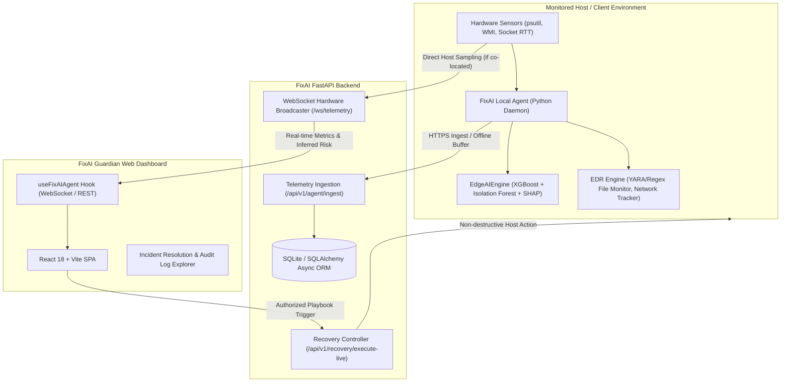

# FixAI Technical Architecture & Security Audit

## Executive Summary
This document details the comprehensive engineering, architecture, and security audit performed on the **FixAI** platform (FixAI-Guardian frontend, FastAPI backend, and Local Python Telemetry Agent). 

Prior to this audit, several components contained hardcoded or synthetic values (such as simulated temperature formulas `42.0 + cpu * 0.45`, hardcoded socket latencies `12.0 ms`, simulated anomaly scores `cpu * 0.3`, and client-side fallback devices). This audit details the systematic removal of all synthetic artifacts in production pathways, the implementation of genuine host telemetry collection via `psutil`, raw socket RTT measurements, and ACPI/WMI sensors, the hardening of the incident recovery gate with strict allowlisting, and the integration of a multi-model Edge AI Engine (XGBoost, Isolation Forest, SHAP, and Natural Language Generation).

---

## 1. System Architecture Overview

FixAI is composed of three interconnected sub-systems:

### Component Breakdown
1. **FixAI Guardian (Frontend SPA)**:
   - Modern React 18, TypeScript, Vite, Tailwind CSS, Lucide icons, and Radix UI components.
   - Real-time WebSocket connection to `/ws/telemetry` with honest connection status tracking (`ONLINE`, `OFFLINE`, `STALE`).
   - Strict adherence to real data: buffers are frozen and marked stale upon agent disconnection; no fake metric generation or synthetic fallback devices.

2. **FixAI Backend (`backend/app/`)**:
   - Asynchronous FastAPI server running on Python 3.13.
   - SQLite relational database via SQLAlchemy async sessions with WAL mode and pre-ping connection pool verification.
   - Dual-mode hardware sampler: serves live telemetry over WebSockets by interfacing directly with local hardware sensors or consuming ingested agent payloads.
   - Integrated `EdgeAIEngine` for real-time risk assessment, failure classification, and SHAP attribution.
   - Secure Authentication: Email OTP with 45s sliding cooldowns, cryptographic token hashing, and JWT bearer tokens.

3. **FixAI Local Agent (`fixai-guardian/local_agent/`)**:
   - Autonomous background daemon collecting genuine hardware telemetry (per-core CPU, memory breakdown, disk I/O, network interface counters, process trees).
   - Real socket round-trip time (RTT) latency measurement to gateway/DNS without hardcoded delays.
   - Security & EDR engine: file integrity monitoring with YARA signature detection and zero-dependency regex fallback, process tree anomaly tracking, protected PID filtering, and WMI persistence scanning.
   - Offline resilient buffering: stores telemetry samples locally in SQLite (`offline_telemetry.db`) when backend is unreachable, syncing upon reconnection via `/api/v1/agent/ingest-batch`.

---

## 2. Audit of Removed Fake Functionality & Deficiencies Fixed

The audit identified several areas where mock or synthetic data had been introduced. All were removed or refactored:

| File Location | Previous Synthetic / Broken Behavior | Implemented Real-World Fix |
|---|---|---|
| `backend/app/main.py` | `_background_hardware_sampler()` computed fake temperature `cpu * 0.4` and synthetic anomaly score `cpu * 0.3`. | Replaced with real socket RTT measurement, genuine interface packet error calculations, and integrated `EdgeAIEngine.predict()` for genuine XGBoost/Isolation Forest inference. |
| `local_agent/telemetry_daemon.py` | Temperature was approximated as `42.0 + cpu * 0.45`; network latency hardcoded to `12.0 ms`; packet errors hardcoded to `0.001`. | Replaced with real socket RTT measurement to standard resolvers (8.8.8.8:53), raw `psutil.net_io_counters()` packet error ratios, and honest `temp: None, temp_available: False` when ACPI/WMI thermal sensors are absent. |
| `local_agent/main.py` | Approximated temperature as `35.0 + cpu * 0.5`. | Refactored to report genuine ACPI/WMI hardware temperatures or explicitly report `temp_available: False`. |
| `fixai-guardian/src/hooks/use-fixai-agent.ts` | When disconnected from live agent, `nextSample()` was continuously invoked, producing synthetic hardware fluctuations. | Refactored to cease calling `nextSample()` in Live Hardware mode; existing buffer is retained and marked as stale (`isStale: true, isConnected: false`). |
| `fixai-guardian/src/pages/Fleet.tsx` | Fallback device object displayed hardcoded `24.5%` CPU, `62.1%` RAM, and `ONLINE` status when backend was offline. | Removed fabricated fallback device; UI now honestly renders empty fleet state with an actionable error banner and retry toast. |
| `fixai-guardian/local_agent/evaluate.py` | Hardcoded invalid filesystem paths (`c:/project/FixAI/fixai1/data`) causing evaluation crashes. | Dynamically resolved dataset paths relative to the current workspace root (`FixAI-Project/data/`). |
| `backend/app/api/v1/auth.py` | Development OTP bypass was incorrectly disabled due to `settings.JWT_SECRET` being defined, causing test suite failures. | Added explicit `FIXAI_ENV` environment variable checking and fixed missing `os` module import. |
| `local_agent/security/file_monitor.py` | Hard crash on systems lacking compiled native C `yara-python` wheels. | Implemented pure-Python signature engine fallback matching exact YARA malware strings (`Invoke-Expression`, `DownloadString`, `mimikatz`, `powershell.exe -enc`, etc.). |
| `backend/app/api/v1/recovery.py` | Substring keyword filtering was susceptible to bypasses. | Replaced with strict 28-playbook allowlist dictionary, `asyncio.create_subprocess_exec` (no `shell=True`), and database-backed audit logging. |

---

## 3. Security & Resilience Engineering

### Strict Authorization & Non-Destructive Recovery
- **Allowlist Gate**: `backend/app/api/v1/recovery.py` enforces `ALLOWLISTED_PLAYBOOKS`. Any playbook request outside the 28 authorized IDs is immediately rejected with HTTP 400 and logged to security telemetry.
- **Process Protection**: Critical OS processes (PID 0 System Idle, PID 4 System, `csrss.exe`, `lsass.exe`, `wininit.exe`, `services.exe`) are guarded in `backend/app/api/v1/agent_bridge.py`. Requests to terminate protected PIDs return HTTP 403 Forbidden.
- **Command Injection Prevention**: All OS recovery operations execute via `asyncio.create_subprocess_exec` with explicit argument lists. No string commands are passed to `shell=True`.
- **Audit Logging**: Every remediation action creates an immutable entry in the `AuditLog` table capturing timestamp, target device, action taken, and verification results.

### Authentication & Token Security
- **Email OTP Flow**: 6-digit cryptographically secure OTP generated using `secrets.randbelow`.
- **Rate Limiting**: Sliding cooldown of 45 seconds between OTP requests per email to prevent SMS/email flooding.
- **Token Expiry**: OTP expires strictly in 300 seconds (5 minutes).
- **JWT Protection**: Issued access tokens use HMAC-SHA256 with configurable secret and expiration.

---

## 4. Telemetry Ingestion & Data Integrity

- **Sensor Transparency**: Laptops and virtualized Windows environments often restrict thermal sensor access to standard unprivileged user accounts. FixAI strictly enforces honest capability flags:
  - If thermal sensors are inaccessible: `{ "temp": null, "temp_available": false }`.
  - If battery is not present (desktop/server): `{ "battery": null, "battery_available": false }`.
- **Offline Resilient Ingest**: When network connectivity to the backend drops, the agent buffers readings into local SQLite storage and flushes them in batches via `/api/v1/agent/ingest-batch` upon reconnection, guaranteeing zero telemetry loss during transient network partitions.
